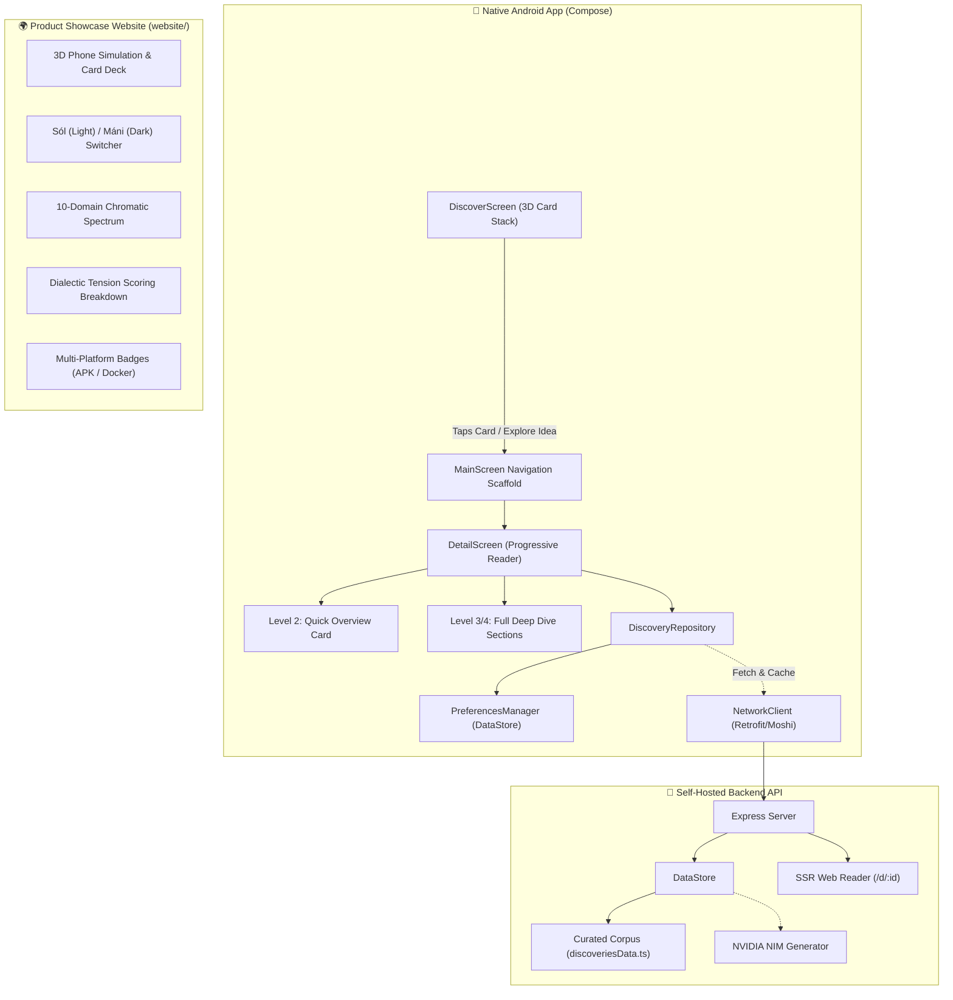

# Architecture: Phils Deep Reading Platform

## System Architecture

## Module Boundaries & Contracts

1. **Android Client (`android/`)**:
   - `DetailScreen`: Reactive Compose layout with dual depth modes (`QUICK_READ`, `DEEP_DIVE`).
   - `CardStack`: Zero-recomposition `graphicsLayer` 3D card physics.
   - `DiscoveryRepository`: Manages API-driven discovery fetching, dynamic in-memory state flow, and local DataStore caching with graceful offline error recovery.

2. **Product Showcase Website (`website/`)**:
   - High-craft, zero-dependency static presentation layer built under `/impeccable` (Persuade mode).
   - Features interactive 3D phone stage simulation, chromatic spectrum selector, dialectic telemetry visualizer, and live theme switcher.
   - Standalone deployment at `website/index.html` with cross-links to the GitHub repository and APK release.

3. **Backend Engine (`server/`)**:
   - `DataStore`: Thread-safe in-memory store delivering enriched discoveries with scored semantic search.
   - `WebReader`: SSR HTML generator with Open Graph cards and responsive typography.
